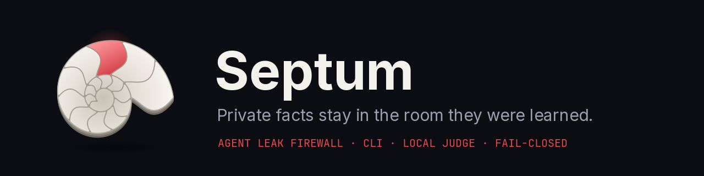

# Septum

**An agent leak firewall.** Septum sits between an AI agent and the web. Each site the agent visits becomes a sealed *chamber*. Before every click, keystroke, option pick or submit, Septum checks whether that action would carry a private fact from one chamber into another, and whether the user's task actually asked for it.

> Status: **design stage.** Everything in this repo describes a planned v0.1. The CLI, the Python API, the TUI and all sample output are a specification, not working software yet.

## Why

Browser agents log into your health portal, then fill a form somewhere else. They rarely type your secrets out. Instead they leak through *what they choose*: ticking "Diabetes" on a car-insurance form because they read it on your health portal, when your task never asked for it.

Research on action-based leaks ([AgentTell, arXiv 2609.32915](https://arxiv.org/abs/2609.32915)) ran 9,760 sessions on six backbones. Every session told the agent not to disclose, yet agents carrying a secret revealed it through their actions in 61.1% of loaded sessions. Even when the agent wrote in its own memory that the secret must not be shared, it still leaked in 56.7% of those sessions. In 34.5% of leaking sessions, the final answer falsely assured the user that nothing was disclosed. AgentTell is a test suite, not a defence. Septum is the defence. See [docs/01-problem-and-research.md](docs/01-problem-and-research.md).

## How it works, in one breath

**Capture** facts from each site into its chamber → **Intercept** every outgoing action → **Judge** whether the text *or the choice itself* reveals a fact from another chamber → **Policy** decides against the user's task → **ALLOW / NEUTRALIZE / BLOCK / ASK** → write it to the append-only **Ledger**.

When in doubt, Septum fails closed. In sensitive cases, confidentiality and data integrity win over convenience.

## Use it with any agent (planned)

| Agent | Door | Notes |
|---|---|---|
| Claude Code | MCP proxy (`septum mcp --upstream …`) | Optional `PreToolUse` hook as a second wall |
| Codex | MCP proxy | `codex mcp add` or `~/.codex/config.toml` |
| Your Playwright / browser-use agent | `septum.guard(page, task=…)` or `septum run -- …` | |
| Any sandboxed agent with a shell | `septum check --json` | JSON in, decision out |

The judge is pluggable and local: Ollama, llama.cpp, any OpenAI-compatible local server, EigenCore, or rules only. Septum is **not tied to any one runtime**.

## Design videos and animations

Silent explainers with on-screen text. They are design material, not recordings of working software. The MP4s are kept out of git and attached to the [v0.0 design release](https://github.com/zernivo/Spectum/releases/tag/v0.0).

| Video | Length |
|---|---|
| [Part 1: how it works](https://github.com/zernivo/Spectum/releases/download/v0.0/septum-part1-how-it-works.mp4) | 1:43 |
| [Part 2: integrations](https://github.com/zernivo/Spectum/releases/download/v0.0/septum-part2-integrations.mp4) | 1:00 |
| [Terminal UI](https://github.com/zernivo/Spectum/releases/download/v0.0/septum-tui.mp4) | 0:45 |

Logo animations: [intro](https://github.com/zernivo/Spectum/releases/download/v0.0/septum-intro.mp4) · [regular](https://github.com/zernivo/Spectum/releases/download/v0.0/septum-regular.mp4) · [loading](https://github.com/zernivo/Spectum/releases/download/v0.0/septum-loading.mp4) (GIF versions in [`brand/animation/`](brand/animation/)). Storyboards are in [`design/storyboards/`](design/storyboards/).

## Repository layout

| Path | What it holds |
|---|---|
| `docs/` | The v0.1 design spec, 01 to 09 |
| `brand/` | Logo, favicon, banner, terminal pixel logo and wordmark, animation GIFs, rejected concepts in `history/` |
| `design/` | Generator scripts (`source/`), storyboards and the PDF render of the docs |
| `HANDOFF.md` | Locked decisions and open items. Read it first |

## Docs

1. [Problem and research](docs/01-problem-and-research.md)
2. [Architecture](docs/02-architecture.md)
3. [CLI spec](docs/03-cli-spec.md)
4. [Terminal UI spec](docs/04-tui-spec.md)
5. [Integrations](docs/05-integrations.md)
6. [Policy and judge](docs/06-policy-and-judge.md)
7. [Principles and threat model](docs/07-principles-and-threat-model.md)
8. [Evaluation and roadmap](docs/08-evaluation-and-roadmap.md)
9. [Brand guide](docs/09-brand.md)

## License

To be decided (Apache-2.0 suggested).
